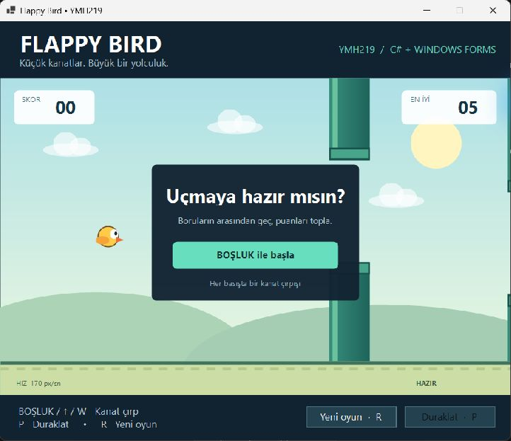
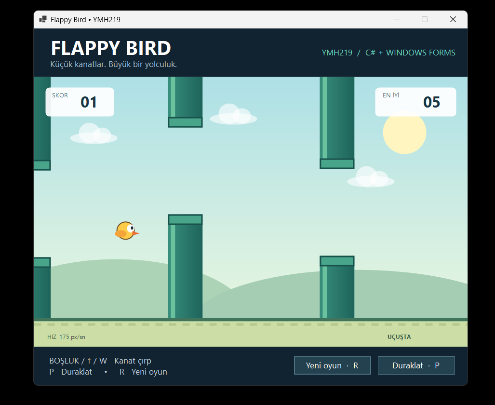

# YMH219 – Flappy Bird

C# ve Windows Forms ile geliştirilen masaüstü oyunu. Kuşu boruların arasından geçirerek puan topla. Her engelden sonra hız biraz artar; engel veya zeminle çarpışınca oyun biter.

## Öğrenci bilgileri

- Ad soyad: Özgür Ulusoy
- Öğrenci numarası: 250541083

## Teknolojiler

- C# / .NET 10
- Windows Forms, System.Drawing
- Windows Forms Timer, Stopwatch
- Harici NuGet paketi veya görsel indirmesi gerektirmez. Görseller kodla çizilir.

## Kurulum ve çalıştırma

Windows ve .NET 10 SDK gereklidir. Visual Studio kullanılıyorsa .NET 10 destekleyen sürüm ve “.NET masaüstü geliştirme” iş yükü kurulmalıdır.

1. Bu depoyu indir veya klonla.
2. `YMH219-FlappyBird.sln` dosyasını Visual Studio ile aç.
3. `FlappyBird` projesini başlangıç projesi seçip F5'e bas.

Alternatif olarak depo klasöründe:

```powershell
dotnet run --project FlappyBird
```

Derleme ve otomatik kontroller:

```powershell
dotnet build FlappyBird -c Release
dotnet run --project FlappyBird.Checks -c Release
```

## Kontroller ve özellikler

| Tuş / düğme | İşlem |
|---|---|
| Boşluk, W veya yukarı ok | Başlat / kanat çırp |
| P veya Esc | Duraklat / devam et |
| R veya Yeni oyun | Skoru sıfırla ve hazır ekranına dön |

- Üç boru çifti sağdan sola ilerler ve ekran dışında yeniden konumlandırılır.
- Her boru çifti yalnızca bir kez puan kazandırır.
- Hız 170 px/sn ile başlar, puan başına 5 artar ve 255'te sınırlanır.
- Odak başka pencereye geçtiğinde oyun duraklar.
- En iyi skor `%LOCALAPPDATA%\YMH219-FlappyBird\best-score.txt` dosyasında saklanır.
- Dosya erişimi başarısız olursa uygulama kapanmaz; alt bölümde bilgi gösterilir.

## Sınıflar

| Sınıf | Sorumluluk |
|---|---|
| `Bird` | Konum, düşey hız, yer çekimi ve kanat çırpma |
| `PipePair` | Boru konumu, açıklık, geçildi bilgisi ve yeniden konumlandırma |
| `GameEngine` | Durum geçişleri, fizik, çarpışma, skor ve hız |
| `GameForm` | Klavye/düğme olayları ve Timer döngüsü |
| `GameCanvas` | Oyun durumunu ekrana çizme |
| `ScoreStore` | Rekoru dosyadan okuma/yazma ve hata yönetimi |

## Ekran görüntüleri

### Başlangıç



### Oyun sırasında



## Doğrulama ve sınırlamalar

- 19 otomatik kontrol geçti: başlangıç, zıplama, duraklama, zemin/üst/alt boru çarpışmaları, skor, tek sefer sayım, boru yenileme, yeniden başlatma, tavan sınırı ve rekor dosyası hata durumları.
- Release derlemesi: 0 hata, 0 uyarı.
- Yalnızca Windows üzerinde çalışır. Ses efekti yoktur. Çarpışma kutusu kuşun gövdesini temsil eder; gaga ve kanat dekoratiftir.
- Rekor kaydı aynı anda tek uygulama örneği için tasarlanmıştır.

## GitHub teslimi

Repository adı: `YMH219-FlappyBird`. `.gitignore`, derleme klasörlerini dışarıda bırakır.
